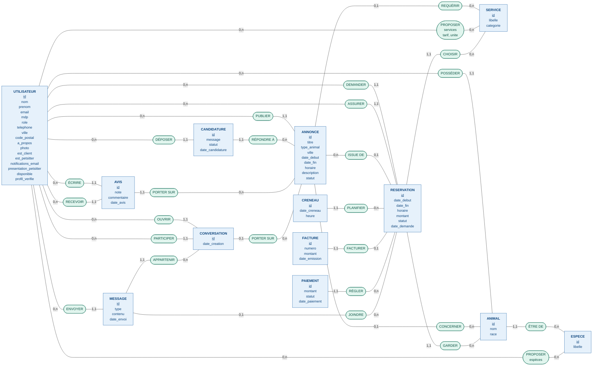

# MCD PetGarden

Entités en bleu, associations en vert. Les identifiants sont soulignés.

## Notes de lecture

- Les clés étrangères n'apparaissent pas comme attributs : elles sont remplacées par des associations avec leurs cardinalités.
- `UTILISATEUR` est relié plusieurs fois à `AVIS` (ÉCRIRE / RECEVOIR), à `RESERVATION` (DEMANDER / ASSURER) et à `CONVERSATION` (OUVRIR / PARTICIPER), selon le rôle joué.
- Les tables de jointure `petsitter_espece` et `petsitter_service` sont devenues les associations PROPOSER (N-N). Celle des services porte `tarif` et `unite`.
- `CRENEAU` est une entité faible : elle est identifiée par `RESERVATION` plus `date_creneau` et `heure`.
- `FACTURE` est en (1,1) côté facture et (0,1) côté réservation (contrainte `unique` sur `id_reservation`).
