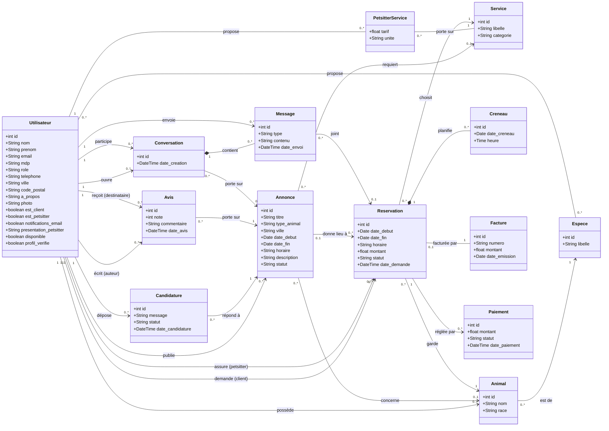

# Diagramme de classes UML – PetGarden

Diagramme généré à partir du MCD PetGarden. Il se visualise dans tout éditeur compatible Mermaid (GitHub, GitLab, VS Code, Obsidian, mermaid.live…).

## Notes de lecture

- Les clés étrangères du modèle relationnel ne figurent pas comme attributs : elles sont représentées par les associations et leurs multiplicités.
- `Utilisateur` est relié plusieurs fois à `Avis` (auteur / destinataire), `Reservation` (client / petsitter) et `Conversation` (ouvre / participe), selon le rôle joué.
- L'association N-N `propose` entre `Utilisateur` et `Espece` correspond à la table `petsitter_espece`.
- L'association N-N entre `Utilisateur` et `Service` (table `petsitter_service`) porte les attributs `tarif` et `unite` : elle est modélisée par la classe d'association `PetsitterService`.
- `Creneau` est une entité faible : elle est liée à `Reservation` par une composition (losange plein), donc supprimée avec la réservation.
- `Message` est lié à `Conversation` par une composition : un message n'existe que dans sa conversation.
- `Facture` est en `1` côté facture et `0..1` côté réservation (contrainte `unique` sur `id_reservation`).
- Les types des attributs (`String`, `int`, `Date`, `float`…) sont déduits des noms du MCD et sont à ajuster selon votre schéma réel.
